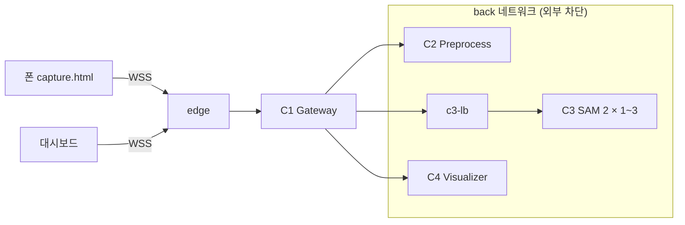
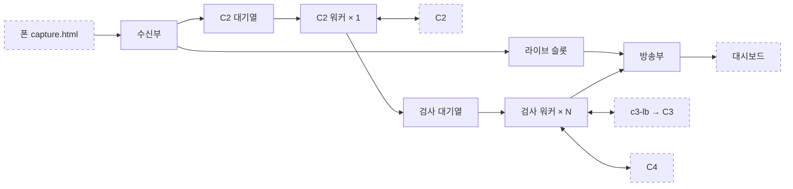

# Pocket Smart Factory PoC 설계 (v2)

## 1. 개요

PoC는 C1이 가운데에서 C2→C3→C4를 호출하는 허브형 6컨테이너 구조로 가고, 무료·로컬 PC·CPU 환경을 기본으로 한다. v1 노트의 뼈대(허브형, edge 분리, front/back 네트워크)는 유지하고 아래 네 가지를 더했다.

| 변경 | v1 노트 | v2 (이 문서) | 이유 |
| --- | --- | --- | --- |
| C1 동시성 | 프레임을 하나씩 끝까지 처리 | C2는 워커 1개가 순서대로, C3·C4는 검사 워커 N개가 동시에. 검사 대상은 버리지 않고 미검사로 기록 | 동시 요청이 없으면 C3 레플리카가 놀아 스케일아웃 효과가 0이고, C2를 동시에 부르면 추적이 깨짐 |
| C2 역할 | 매 프레임 박스 검출 | 검사선 통과 추적, 과자당 1회만 C3 호출 | 같은 과자가 수십 번 판정·집계되는 문제 제거, C3 부하 수십 분의 1 |
| 실행 환경 | GPU 전제 | CPU 기본, GPU는 별도 compose 파일 | GPU 없는 PC에서 compose 실패 방지, 단일 GPU에서 레플리카 3개는 효과 미미 |
| 대시보드 | 결과 화면 하나 | 라이브 영상과 검사 결과 피드 분리 | C2~C4가 검사 대상 프레임만 처리해도 라이브 화면이 끊기지 않음 |

검사 로직은 C1~C4 네 개에만 있고, edge와 c3-lb는 인프라 계층이다. 슬라이드의 "4단계 컨테이너" 설명과는 이 구분으로 맞춘다.

## 2. 전체 구성

컨테이너는 6개이고, 검사 로직은 C1~C4 네 개에만 있다. C1이 가운데에서 C2, C3, C4를 차례로 호출하며, 상태가 없는 C3만 레플리카로 복제한다.



폰과 대시보드는 edge를 거쳐서만 C1에 닿고, C2~C4는 외부와 차단된 back 네트워크 안에만 있다.

| 컨테이너 | 계층 | 역할 | 레플리카 | 상태 |
| --- | --- | --- | --- | --- |
| edge | 인프라 | HTTPS 처리, 정적 페이지 제공, WebSocket·`/stats`·`/api/` 프록시 | 1 | 없음 |
| C1 Gateway | 서비스 | 프레임 수신, C2→C3→C4 호출, 결과 푸시, 지연 측정 | 1 | 대기열, 통계 |
| C2 Preprocess | 서비스 | 조명 보정, 과자 검출, 검사선 통과 선별 | **1 고정** | 라인별 과자 위치 |
| c3-lb | 인프라 | C3 레플리카로 요청 분산 | 1 | 없음 |
| C3 SAM 2 | 서비스 | 마스크 추출, 원형도·솔리디티 판정 | 1 ~ 3 | 없음 |
| C4 Visualizer | 서비스 | 원본 마킹, 판정 이력 저장 | 1 | SQLite 파일 |

## 3. C1 Gateway (FastAPI + WebSocket)

C1은 프레임을 두 구간으로 나눠 처리한다. C2는 모든 프레임을 순서대로 하나씩 처리하고, 검사 대상이 나온 프레임만 여러 검사 워커가 동시에 C3·C4로 보낸다. 라이브 영상은 파이프라인과 무관하게 항상 흐른다. C1은 이미지를 디코드하지 않고 바이트만 옮긴다.



점선 상자는 C1 밖의 컨테이너와 화면이다. 동시 처리는 검사 워커 구간에만 있고, C2 구간은 항상 한 번에 하나다.

**내부 부품**

| 부품 | 하는 일 | 동시성 |
| --- | --- | --- |
| 수신부 (`/ws/ingest`) | `frame_id`, `stream_id`, 수신 시각을 붙여 라이브 슬롯과 C2 대기열에 넣음 | 입력 연결당 1 |
| 방송부 (`/ws/dashboard`) | 라이브 프레임, 검사 결과, 통계를 대시보드로 푸시 | 대시보드 연결당 전송 태스크 1 |
| C2 워커 | C2 대기열에서 순서대로 꺼내 C2 호출, 대상이 있으면 검사 대기열에 넣음 | **1 고정** |
| 검사 워커 | C3 호출 → C4 호출 → 결과를 방송부로 | N = C3 레플리카 수 |
| 통계부 | 처리량, 단계별 지연, 미검사·실패·폐기 수 집계 | - |

**대기열과 넘침 정책**

| 대기열 | 크기 | 넘치면 | 이유 |
| --- | --- | --- | --- |
| 라이브 슬롯 (대시보드별) | 1 | 덮어씀 | 느린 화면은 프레임이 듬성해질 뿐, 다른 연결에 영향 없음 |
| 결과 대기열 (대시보드별) | 100 | 가장 오래된 결과 폐기 | 결과는 개수가 적고 하나하나 중요해서 덮어쓰지 않음 |
| C2 대기열 | 4 | 가장 오래된 프레임 폐기 | C2는 수 ms라 거의 차지 않음. 차면 C2 이상 신호 |
| 검사 대기열 | 20 | 해당 과자를 미검사(SKIPPED)로 기록 | 게이팅 이후 프레임 하나가 곧 과자 하나의 유일한 검사 기회 |

**설계 원칙**

- **C2는 순서대로만 호출한다.** C2는 직전 프레임과 비교해 검사선 통과를 판단한다. 동시에 보내면 프레임 순서가 뒤집히고, 앞단에서 버린 프레임은 C2가 못 봐서 추적이 깨진다. C2 워커를 1개로 두면 도착 순서가 곧 촬영 순서다.
- **검사 대상은 조용히 버리지 않는다.** 라이브 프레임은 마음껏 버리지만, 검사 대기열이 넘친 과자는 SKIPPED로 기록해 대시보드에 숫자로 보여 준다. 품질 검사에서는 놓쳤다는 사실을 아는 것이 중요하고, 이 숫자가 스케일아웃의 근거가 된다.
- **원본 보관소를 두지 않는다.** 검사 작업이 C2 호출 때 받은 원본 바이트를 C4 호출까지 들고 간다. 별도 저장소와 삭제 타이머가 필요 없고, 작업이 끝나면 메모리도 풀린다.
- **스트림별로 분리한다.** 폰을 여러 대 연결해도 섞이지 않게 모든 메시지에 `stream_id`를 붙이고, C2는 스트림별로 추적 상태를 둔다.
- **지연은 C1 수신 시각 기준으로 잰다.** 폰 시계는 PC와 어긋나 지연이 음수로 나올 수 있다. 폰이 찍은 시각은 참고용으로만 남긴다.
- **보내는 쪽에서 속도를 조절한다.** C1이 못 따라가면 프레임이 네트워크 버퍼에 쌓여 영상이 몇 초씩 늦어진다. `capture.html`은 `ws.bufferedAmount`가 0일 때만 다음 프레임을 보낸다.
- **HTTP 클라이언트는 하나를 공유한다.** `httpx.AsyncClient` 하나를 앱 전체에서 써서 연결을 재사용한다.

**타임아웃과 실패 처리**

| 호출 | 타임아웃 | 실패 시 |
| --- | --- | --- |
| C2 | 1초 | 그 프레임 건너뜀, C2 오류 수 증가 |
| C3 | 10초 (CPU) / 2초 (GPU) | 해당 과자를 실패(FAILED)로 기록, 재시도 없음 |
| C4 | 1초 | 마킹 없이 판정 결과만 대시보드로 전송 |

미검사(대기열 넘침)와 실패(호출 오류)는 원인이 다르므로 따로 센다. 앞의 것은 용량 부족, 뒤의 것은 장애다.

**워커 수 감각**

시뮬레이터 기본값(3개 라인, 130 px/s, 과자 간격 168 px)에서는 초당 약 2.3개의 과자가 검사선을 지난다. 같은 프레임에서 통과한 과자는 한 번에 처리되므로 C3 요청은 그보다 적다. C3는 레플리카마다 한 번에 한 건만 처리하므로(임베딩을 내부에 들고 있어 요청이 겹치면 섞임) 검사 워커 수는 레플리카 수와 같게 둔다. 워커가 더 많으면 남는 요청이 C3 안에서 기다리다 타임아웃으로 실패(FAILED)가 되고, 같게 두면 C1 검사 대기열에서 기다리다 넘칠 때 미검사(SKIPPED)로 정확히 잡힌다.

실측(16코어 CPU, `sam2.1_hiera_tiny`): 프레임 한 장 2.2~2.9초(코어 전부), 5스레드로 제한해도 약 3.2초. 레플리카 1개는 초당 약 0.35건, 3개는 약 0.9건으로 추정된다. 시뮬레이터 기본 속도(초당 2.3개)는 3개로도 따라가지 못하므로 시연은 컨베이어 속도 40~50 px/s(초당 0.7~0.9개)로 한다.

**엔드포인트**

| 엔드포인트 | 호출자 | 내용 |
| --- | --- | --- |
| `WS /ws/ingest?stream_id=…` | 폰 촬영 페이지 | 메시지 하나 = JPEG 한 장 (바이너리). 응답 없음 |
| `WS /ws/dashboard` | 대시보드 | JSON 텍스트 메시지 푸시. `type`이 `live`(`stream_id`, `frame_id`, `jpeg`), `result`(`frame`, `results`, `timing`, `jpeg`=마킹 이미지 또는 null), `stats`(1초마다, `/stats`와 같은 내용). `jpeg`는 base64 |
| `GET /health` | compose | 헬스체크 |
| `GET /stats` | 대시보드, 측정 스크립트 | 처리량, 단계별 지연, 미검사·실패·폐기 수, 대기열 길이 |
| `GET /api/qr` | 대시보드 | JSON `{url, stream_id, qr_png}` (`qr_png`는 base64 PNG). 호출할 때마다 새 `stream_id` (10장) |

## 4. C2 Preprocess (OpenCV, CPU)

C2의 진짜 임무는 C3에 보낼 일을 줄이는 것이다. 과자가 검사선을 막 지나간 프레임만 골라, 그 과자의 박스를 SAM 2 프롬프트로 넘긴다.

**처리 순서**

1. JPEG 디코드
2. 조명 보정: LAB 색공간 L 채널에 CLAHE, 노이즈가 심하면 가벼운 블러
3. 과자 후보 검출: HSV 임계값(어두운 벨트 위 갈색) → 모폴로지 정리 → 컨투어 → 면적 필터 → 박스
4. 라인 배정: 박스 중심 y좌표로 몇 번째 컨베이어인지 결정
5. 검사선 통과 추적 (아래)
6. 화면 가장자리에 닿은 박스 제외 (`EDGE_MARGIN`): 잘린 과자는 원형도가 왜곡된다
7. 응답: 검사 대상 `targets[]` (JSON, 원본 좌표). 대상이 없으면 빈 목록. 이미지는 돌려주지 않는다

**검사선 통과 추적**

과자 하나는 화면을 가로지르는 동안 수십 프레임에 찍힌다. 매 프레임 판정하면 불량 1개가 수십 개로 집계되고 C3 부하도 수십 배가 된다. 그래서 C2가 과자마다 트랙을 두고 프레임 사이에 짝지어 따라가며, 검사선 앞(오른쪽)에서 보였던 트랙이 검사선을 지나면 그 트랙을 한 번만 대상으로 고른다. 통과한 과자에는 `cookie_id`를 새로 부여한다.

이 방식은 컨베이어 진행 방향(시뮬레이터 기준 오른쪽→왼쪽)과 검사선 위치(`SCAN_X_RATIO`, 화면 폭 비율)를 설정으로 받는다.

**손떨림 대응 (거치대 없이 폰을 손에 든 경우)**

손에 든 폰은 화면 전체가 프레임마다 수십 px씩 흔들리고, 흔들림이 크면 블러가 생긴다. 직전 프레임의 가장 가까운 과자와 짝짓기만 하면 과자가 일정 간격으로 놓여 있어 옆 과자와 바뀌고, 검사선을 왔다 갔다 해서 중복·누락이 생긴다. 영상을 보정(warp)하지 않고 추적만 흔들림에 강하게 만들어, 박스는 그대로 원본 좌표로 보낸다.

| 문제 | 대응 |
| --- | --- |
| 흔들림으로 짝짓기가 옆 과자로 바뀜 | 모든 과자가 함께 움직인 양(벨트 이동 + 흔들림)을 프레임마다 추정해 빼고 짝지음. 한 칸 밀린 짝짓기도 거의 다 맞으므로 예상 이동량(벨트 속도 평균)에서 멀수록 크게 감점하고, 크게 빗나간 프레임만 감점을 약하게 해 다시 추정 |
| 흔들려서 검사선을 왕복 | 트랙당 한 번만 검사. 검사선 앞으로 과자 크기의 절반 이상 떨어져 보인 적이 있어야 통과로 인정 |
| 블러로 검출이 잠깐 끊김 | 트랙을 8프레임까지 유지하고, 끊겼던 트랙은 두 배 범위에서 다시 짝지음 |
| 블러 프레임이 C3로 감 | 검사선을 지난 뒤 흔들림이 크거나 그 과자의 최고 선명도(라플라시안 분산) 대비 60% 미만이면 최대 4프레임 기다림 |
| 폰이 기울어 라인 배정이 틀림 | 매 프레임 같은 라인으로 보이는 과자 쌍의 기울기로 보정한 뒤 위아래로 묶어 번호를 매김 |
| 화면 속 노란 UI 등 정지 물체 | 벨트와 같이 움직이지 않는 트랙은 제외 |

시뮬레이터 화면을 흔들리는 폰으로 찍은 합성 영상(40초, 과자 약 75개, 시드 3개)으로 확인한 결과: 고정·보통 손떨림(±8px, ±0.8°)·심한 손떨림(±20px, ±2°, 가끔 튐)에서 누락·중복·라인 오류 0건, 아주 심한 손떨림(±35px, ±3.5°, 자주 튐)에서 검출 96~97%, 중복 0~1건. C2 처리는 프레임당 평균 약 10ms. 검사선은 화면 기준이라 폰 위치에 따라 시뮬레이터의 검사선과 다를 수 있지만, 모든 과자가 화면을 가로지르며 한 번씩 지나므로 집계는 맞는다.

**레플리카는 반드시 1개**

추적 때문에 C2는 상태를 가지며, 추적 상태는 stream_id별로 따로 둔다. C1의 C2 워커가 프레임을 순서대로 하나씩 보내므로 도착 순서가 곧 촬영 순서다. 레플리카를 늘리면 프레임이 서로 다른 C2로 흩어져 통과 판정이 깨진다. 상태가 없는 C3만 복제한다는 대비가 "병목인 C3만 독립적으로 확장한다"는 설계 근거가 된다.

**엔드포인트**: `POST /process` (C1 호출), `GET /health`

## 5. C3 SAM 2 Inference + c3-lb

C3는 상태가 없는 판정기다. 박스 프롬프트로 과자 경계를 픽셀 단위로 따고, 원형도와 솔리디티 두 지표로 정상/불량을 정한다. 상태가 없으니 마음대로 복제할 수 있다.

**추론**

- 컨테이너 시작 시 `sam2.1_hiera_tiny` 체크포인트를 한 번만 로딩한다. 가중치는 이미지에 넣지 않고 `./weights`를 읽기전용 마운트한다.
- `SAM2ImagePredictor`로 프레임당 이미지 임베딩을 한 번만 계산하고, 그 프레임의 박스 프롬프트들을 한 번에 디코딩한다. 비용 대부분이 임베딩이라 과자가 여러 개여도 거의 같은 시간이 걸린다.
- 입력은 원본 프레임 그대로다. `set_image()`가 모델 입력 크기로 맞추는 일을 내부에서 하고, 마스크도 원본 해상도로 돌려주므로 C2·C4에 리사이즈·역변환이 필요 없다.
- `DEVICE=cpu`가 기본. CPU에서는 프레임당 2~3초 걸린다 (3장 실측, PC 사양에 따라 차이가 큼). 레플리카마다 `TORCH_THREADS`(코어 수 ÷ 레플리카 수)로 코어를 나눠 쓴다. 레플리카 수를 바꾸면 이 값도 같이 바꾼다. 레플리카 1개로 측정할 때 코어의 1/3만 쓰면 스케일아웃 효과가 부풀려진다.
- 모델 로딩이 끝나기 전에는 `/health`가 실패를 반환한다. compose는 C3가 healthy가 될 때까지 c3-lb를 띄우지 않지만, 무료 Nginx는 `/health`를 직접 확인하지 않는다. 그래서 레플리카를 늘린 뒤에는 새 레플리카가 healthy가 된 다음 c3-lb를 재시작한다 (8장).
- torch는 빌드 인자 `TORCH_INDEX`로 받는다. 기본값은 CPU 전용 휠(`https://download.pytorch.org/whl/cpu`)이라 이미지가 수 GB 작다. GPU용 compose 파일이 이 값을 CUDA 휠로 바꾼다.

**판정**

마스크에서 가장 큰 외곽선을 뽑고, 픽셀 계단 때문에 둘레가 과대 측정되지 않도록 `approxPolyDP` 등으로 다듬은 뒤 두 지표를 계산한다.

```latex
\text{Circularity} = \frac{4\pi \cdot A}{P^2} \qquad \text{Solidity} = \frac{A}{A_{\text{convex hull}}}
```

| 결함 유형 (시뮬레이터) | 원형도 | 솔리디티 |
| --- | --- | --- |
| 한쪽 파임 (bite) | 떨어짐 | 크게 떨어짐 |
| 조각 결손 (wedge) | 떨어짐 | 크게 떨어짐 |
| 단면 절단 (cut) | 떨어짐 | 거의 그대로 (볼록 형태) |
| 반쪽 파손 (half) | 크게 떨어짐 | 거의 그대로 |

두 지표가 서로 다른 결함을 잡으므로 둘 중 하나라도 임계값 미만이면 불량(NG)으로 판정한다.

아래 임계값은 이 계산 방식을 전제로 한다. 방식을 바꾸면 임계값도 다시 정해야 한다.

1. `cv2.findContours(mask, cv2.RETR_EXTERNAL, cv2.CHAIN_APPROX_NONE)`에서 면적이 가장 큰 외곽선 하나를 고름 (초코칩 등으로 생긴 마스크 구멍은 무시됨)
2. `cv2.approxPolyDP(외곽선, 1.0, True)`로 다듬음 (허용 오차 1px)
3. 다듬은 외곽선으로 `area = cv2.contourArea`, `perimeter = cv2.arcLength(…, True)`, `hull = cv2.contourArea(cv2.convexHull(…))`
4. 원형도 = 4π·area / perimeter², 솔리디티 = area / hull

**임계값: 원형도 0.96, 솔리디티 0.985**

`simulator.html`의 형상 생성 코드(`makeShape`)를 그대로 옮겨, 형상마다 수백 개를 픽셀 마스크로 그린 뒤 위 방식으로 계산했다. 과자 지름 78px, 결손 크기 55%(시뮬레이터 기본값) 기준이다.

| 형상 | 원형도 | 솔리디티 | 잡는 지표 |
| --- | --- | --- | --- |
| 정상 | 0.986 ~ 0.990 | 1.000 | - |
| 한쪽 파임 (bite) | ≤ 0.934 | ≤ 0.974 | 둘 다 |
| 단면 절단 (cut) | ≤ 0.949 | 1.000 | 원형도 |
| 조각 결손 (wedge) | ≤ 0.662 | ≤ 0.897 | 둘 다 |
| 반쪽 파손 (half) | ≤ 0.805 | 1.000 | 원형도 |

- 정상을 불량으로 잘못 보는 경우는 과자 지름 40~156px에서 0건이다.
- 결손 크기 40% 이상이면 불량을 99% 이상 잡는다. 10~20%처럼 작은 결손은 정상과 값이 겹쳐 75~90%만 잡힌다. 시연은 결손 크기 40% 이상으로 한다.
- 외곽선을 `approxPolyDP`(허용 오차 1px)로 다듬지 않으면 완벽한 원도 원형도가 0.89로 나온다. 픽셀 계단만큼 둘레가 길게 재지기 때문이다.
- 카메라가 비스듬해 원이 타원으로 찍혀도 영향이 작다. 세로가 20% 눌린 타원의 원형도는 약 0.98이다.

이 값은 이상적인 마스크 기준이다. SAM 2 마스크의 경계 오차와 그림자는 반영되지 않았으므로, 통합 후 대시보드에서 정상 과자 값이 0.96 근처까지 내려오면 조정한다 (11장 2단계).

**c3-lb (Nginx)**

- `upstream`에 `c3-sam2:8000` 하나를 적고 `least_conn`을 쓴다. Docker DNS가 레플리카 IP를 모두 돌려주므로 각 레플리카가 upstream 서버로 등록된다.
- 라운드로빈 대신 `least_conn`을 쓰는 이유: 과자 수에 따라 추론 시간이 들쭉날쭉해서, 처리 중인 요청이 적은 레플리카로 보내는 편이 대기가 짧다.
- 레플리카 수를 바꾸거나 C3가 재시작되면 c3-lb도 재시작한다 (9장).

**엔드포인트**: `POST /infer`, `GET /health`

## 6. C4 Visualizer (OpenCV + Pillow, SQLite)

C4는 C3의 판정 결과를 원본 프레임 위에 그려서 C1에 돌려주고, 판정 이력을 남긴다.

**처리 순서**

1. C1에서 원본 JPEG와 `results[]`를 받음 (폴리곤은 원본 좌표라 그대로 그림)
2. 불량은 빨간 반투명 마스크와 굵은 외곽선, 정상은 초록 외곽선
3. 과자마다 라인 번호, 원형도, 솔리디티, 판정 텍스트 표시. 한글은 OpenCV `putText`가 지원하지 않으므로 텍스트만 Pillow로 그린다
4. SQLite `inspections` 테이블에 한 줄씩 기록
5. 불량이면 마킹 이미지를 `./data/defects/{stream_id}_{frame_id}_{cookie_id}.jpg`로 저장 (번호가 스트림별이라 `stream_id`를 붙임)
6. 마킹 이미지 JPEG를 C1에 응답으로 반환

**inspections 테이블**

| 컬럼 | 내용 |
| --- | --- |
| `stream_id`, `frame_id`, `cookie_id` | 스트림, 프레임, 과자 식별 (번호는 스트림별) |
| `line` | 컨베이어 라인 번호 |
| `verdict` | OK / NG |
| `circularity`, `solidity` | 판정 근거 수치 |
| `ts_capture`, `ts_done` | 촬영 시각, 판정 완료 시각 |
| `image_path` | 불량 이미지 경로 (정상은 비움) |

SQLite는 파일 하나(`./data/inspections.db`)라 별도 DB 컨테이너가 필요 없다. C4가 레플리카 1개라서 컨테이너 사이 쓰기 충돌은 없고, 검사 워커 여러 개가 동시에 부르는 것은 C4 안에서 연결 하나를 잠금으로 보호해 처리한다. 한글 텍스트용 나눔 폰트는 C4 Dockerfile에서 설치한다. 이 테이블과 불량 이미지는 나중에 오검출 사례를 다시 보고 임계값을 조정할 때 쓴다.

**엔드포인트**: `POST /render`, `GET /health`

## 7. 메시지 규격과 설정값

내부 호출은 모두 `multipart/form-data`로 `meta`(JSON)와 `image`(JPEG 바이너리) 두 파트를 보낸다. 이미지를 JSON 안에 base64로 넣지 않는다. 메시지 정의는 `common/schema.py`(Pydantic) 한 곳에 두고, 각 서비스 Dockerfile이 `COPY common/`으로 이미지에 넣는다. 이를 위해 빌드 기준(context)을 프로젝트 폴더 전체로 둔다 (8장).

`common/schema.py`가 규격의 기준이다. 담당자가 서로 다른 경계(C1↔C2, C1↔C3, C1↔C4)만 정의하고, 한 사람이 양쪽을 다 만드는 폰→C1, C1→대시보드 메시지는 넣지 않는다. 바꿀 때는 PR로 올리고 양쪽 담당자가 확인한다. 좌표는 모두 원본 프레임 픽셀 기준이다.

| 호출 | meta | image | 응답 |
| --- | --- | --- | --- |
| C1 → C2 `POST /process` | `FrameMeta` (`frame_id`, `stream_id`, `ts_recv`, `ts_capture`) | 원본 | JSON `PreprocessResponse` (`targets[]`: `cookie_id`, `line`, `box`) |
| C1 → C3 `POST /infer` | `InferRequest` (`frame`, `targets[]`) | 원본 | JSON `InferResponse` (`results[]`: `cookie_id`, `line`, `polygon`, `area`, `perimeter`, `circularity`, `solidity`, `verdict`) |
| C1 → C4 `POST /render` | `RenderRequest` (`frame`, `results[]`) | 원본 | JPEG (마킹 이미지) |

C1은 C2 호출 때 받은 원본 바이트를 C3·C4 호출에도 그대로 쓴다. 단계별 호출 전후 시각(`timing`)은 C1 안에서만 쓰므로 규격에 넣지 않는다.

**설정값 (.env)**

| 항목 | 초기값 | 사용처 | 비고 |
| --- | --- | --- | --- |
| `INSPECT_WORKERS` | 3 | C1 | C3 레플리카 수와 같게 (3장) |
| `INSPECT_QUEUE` | 20 | C1 | 넘치면 미검사(SKIPPED) |
| `C2_QUEUE` | 4 | C1 | 넘치면 가장 오래된 프레임 폐기 |
| `TIMEOUT_C3` | 10 (초) | C1 | CPU 기준, GPU면 2 정도 |
| `PUBLIC_BASE_URL` | `make-cert.sh`가 자동 기록 | C1 | QR에 넣을 PC 주소 `https://{PC IP}` (10장) |
| `SCAN_X_RATIO` | 0.34 | C2 | 시뮬레이터 검사선과 동일 |
| `FLOW_DIRECTION` | left | C2 | 컨베이어 진행 방향 |
| `EDGE_MARGIN` | 10 (px) | C2 | 가장자리 과자 제외 |
| `SAM2_MODEL` | sam2.1_hiera_tiny | C3 |  |
| `DEVICE` | cpu | C3 | GPU override에서 cuda |
| `TORCH_THREADS` | 코어 수 ÷ 레플리카 수 | C3 | `make-cert.sh`가 `.env`를 처음 만들 때 자동 설정. 레플리카 수를 바꾸면 같이 변경 |
| `CIRC_THRESHOLD` | 0.96 | C3 | 근거는 5장, 필요하면 대시보드 값을 보고 조정 |
| `SOLIDITY_THRESHOLD` | 0.985 | C3 | 근거는 5장, 필요하면 대시보드 값을 보고 조정 |

임계값을 설정으로 빼 두면 재빌드 없이 조정할 수 있다. 단 `docker compose restart`는 `.env`를 다시 읽지 않으므로 컨테이너를 새로 만들어야 한다. C3는 새로 만들면 IP가 바뀌므로 c3-lb도 재시작한다.

```bash
docker compose up -d c3-sam2      # 바뀐 .env로 C3를 새로 만듦
docker compose ps                 # c3-sam2가 모두 healthy인지 확인
docker compose restart c3-lb
```

`.env`는 Git에서 제외되므로, 정한 값은 `.env.example`에도 적어 커밋해 팀이 같은 값에서 시작하게 한다.

## 8. docker-compose 구성

기본 파일은 CPU로 어디서나 뜨게 하고, GPU 설정은 별도 파일로 덧붙인다. v1 노트의 URL 꺾쇠(`<http://...>`) 오류를 고쳤고, 비어 있던 C3 healthcheck를 채웠다. edge는 C1에만 닿으면 되므로 front 네트워크에만 둔다.

C1~C4는 모두 `common/`을 복사해야 하므로 빌드 기준을 프로젝트 폴더(`.`)로 두고 Dockerfile 경로만 따로 지정한다. `build: ./c1_gateway`처럼 서비스 폴더를 기준으로 두면 Docker가 그 폴더 밖의 `common/`을 읽을 수 없다. Dockerfile 안의 경로도 프로젝트 폴더 기준으로 쓴다.

```dockerfile
COPY common/ /app/common/
COPY c1_gateway/ /app/c1_gateway/
```

**docker-compose.yml (기본, CPU)**

```yaml
services:
  edge:
    image: nginx:1.27
    ports: ["443:443"]
    volumes:
      - ./edge/nginx.conf:/etc/nginx/nginx.conf:ro
      - ./edge/certs:/certs:ro
      - ./web:/usr/share/nginx/html:ro
    depends_on: [c1-gateway]
    networks: [front]

  c1-gateway:
    build: { context: ., dockerfile: c1_gateway/Dockerfile }
    env_file: .env
    environment:
      C2_URL: http://c2-preprocess:8000
      C3_URL: http://c3-lb:80
      C4_URL: http://c4-visualizer:8000
    networks: [front, back]

  c2-preprocess:
    build: { context: ., dockerfile: c2_preprocess/Dockerfile }
    env_file: .env
    networks: [back]            # 상태 보유: 레플리카 1개 고정

  c3-lb:
    image: nginx:1.27
    volumes: [./c3_lb/nginx.conf:/etc/nginx/nginx.conf:ro]
    depends_on:
      c3-sam2: { condition: service_healthy }
    networks: [back]

  c3-sam2:
    build: { context: ., dockerfile: c3_sam2/Dockerfile }
    env_file: .env
    volumes: [./weights:/weights:ro]
    deploy:
      replicas: 3
    healthcheck:
      test: ["CMD", "python", "-c", "import urllib.request; urllib.request.urlopen('http://localhost:8000/health')"]
      interval: 10s
      timeout: 3s
      retries: 3
      start_period: 90s         # SAM 2 로딩 시간
    networks: [back]

  c4-visualizer:
    build: { context: ., dockerfile: c4_visualizer/Dockerfile }
    env_file: .env
    volumes: [./data:/data]
    networks: [back]

networks:
  front:
  back:
    internal: true              # 외부 인터넷 차단
```

**docker-compose.gpu.yml (NVIDIA GPU가 있을 때만)**

```yaml
services:
  c3-sam2:
    build:
      args:
        TORCH_INDEX: https://download.pytorch.org/whl/cu126   # PC의 NVIDIA 드라이버가 지원하는 CUDA 버전으로
    environment: { DEVICE: cuda }
    deploy:
      replicas: 1               # GPU 1장이면 1개가 기본
      resources:
        reservations:
          devices: [{ driver: nvidia, count: 1, capabilities: [gpu] }]
```

**실행 명령**

| 상황 | 명령 |
| --- | --- |
| CPU 기본 | `docker compose up -d --build` |
| GPU 사용 | `docker compose -f docker-compose.yml -f docker-compose.gpu.yml up -d --build` |
| 레플리카 변경 | `.env`의 `TORCH_THREADS`, `INSPECT_WORKERS` 변경 → `docker compose up -d --scale c3-sam2=1` → `docker compose ps`로 c3-sam2가 모두 healthy인지 확인 → `docker compose restart c3-lb` |

GPU 1장에서 레플리카를 여러 개 띄우면 VRAM만 배로 쓰고 처리량은 거의 늘지 않는다. 스케일아웃 시연은 CPU 환경(코어 분할)이나 GPU가 여러 장인 환경에서 한다. `back` 네트워크를 `internal`로 두면 C3가 실행 중 가중치를 내려받을 수 없으므로, 체크포인트는 미리 `./weights`에 받아 둔다.

## 9. Nginx와 HTTPS 주의사항

폰 브라우저는 `localhost`가 아니면 HTTPS에서만 카메라를 열어 준다. edge가 HTTPS를 맡고, WebSocket을 C1로 넘길 때 두 가지 설정이 빠지면 연결이 안 되거나 1분마다 끊긴다.

**edge: WebSocket 프록시 필수 설정**

```
location /ws/ {
    proxy_pass http://c1-gateway:8000;
    proxy_http_version 1.1;
    proxy_set_header Upgrade $http_upgrade;
    proxy_set_header Connection "upgrade";
    proxy_read_timeout 3600s;     # 기본 60초면 대시보드가 주기적으로 끊김
}
location = /stats {
    proxy_pass http://c1-gateway:8000;   # C1은 외부 포트가 없으므로 측정 스크립트도 edge를 거침
}
location /api/ {
    proxy_pass http://c1-gateway:8000;   # QR 등 대시보드용 API
}
```

**c3-lb: upstream 설정**

```
upstream c3 {
    least_conn;
    server c3-sam2:8000;          # 시작 시 레플리카 IP 전부로 해석됨
}
location / {
    proxy_pass http://c3;
    proxy_next_upstream error;    # 연결 실패 때만 다른 레플리카로 재시도
    proxy_read_timeout 12s;       # C1의 TIMEOUT_C3(10초)보다 약간 길게
}
```

Nginx는 이미 레플리카에 보낸 POST 요청을 기본적으로 다른 레플리카로 다시 보내지 않는다 (1.9.13부터). 다만 기본 설정은 연결 단계 타임아웃에도 재시도하므로, C3가 과부하일 때 재시도가 부하를 키우지 않도록 연결 실패 때만 재시도한다고 명시해 둔다.

Nginx는 시작할 때 한 번만 이름을 해석한다. 레플리카 수를 바꾸거나 C3 컨테이너가 재시작되어 IP가 바뀌면 `docker compose restart c3-lb`로 다시 읽게 한다. PoC에서는 이 규칙만 지키면 된다.

**인증서**

| 방법 | 장점 | 주의 |
| --- | --- | --- |
| mkcert (기본) | 로컬에서 완결, 주소 고정 | 생성된 루트 인증서를 폰에 설치하고 신뢰 설정해야 함 |
| 자체 서명 인증서 | 도구 불필요 | iOS Safari는 경고를 넘겨도 WSS 연결을 조용히 거부하는 경우가 있음 |
| cloudflared 퀵 터널 (예비) | 계정 없이 공인 HTTPS 주소 즉시 발급 | 실행할 때마다 주소가 바뀜, 외부 경유라 지연 증가 |

mkcert로 시작하고, 폰 인증서 설치가 막히면 cloudflared로 edge(443)를 열어 우회한다.

## 10. 대시보드와 정적 페이지

대시보드는 라이브 영상과 검사 결과 피드를 나눠 보여 준다. 라이브 영역은 C1이 받은 원본을 그대로 띄우므로 C3가 느려도 끊기지 않고, 결과 피드는 검사선을 지난 과자의 마킹 이미지만 쌓인다.

| 영역 | 데이터 출처 | 내용 |
| --- | --- | --- |
| 라이브 영상 | C1 중계 (원본) | 카메라 화면 그대로 |
| 검사 결과 피드 | C4 마킹 이미지 | 최근 판정 이미지, 불량은 강조 |
| 집계 | C1 `/stats` | 검사 수, 정상, 불량, 불량률, 미검사(SKIPPED), 실패, 폐기 프레임 수 |
| 지연 막대 | C1 `timing` | C2 / C3 / C4 / 전체 평균 지연 |

정적 페이지는 모두 edge가 `./web`에서 제공한다. React 없이 HTML과 바닐라 JS로 충분하다.

| 페이지 | 용도 |
| --- | --- |
| `capture.html` | 폰 카메라 촬영, 캔버스에서 JPEG로 인코딩해 WSS 전송 (해상도·전송 fps 조절, 이전 프레임 전송이 끝난 뒤에만 다음 프레임 전송). QR로 열리며 주소의 `stream_id`를 그대로 씀 |
| `dashboard.html` | 위 네 영역 |
| `simulator.html` | 기존 컨베이어 시뮬레이터 그대로. PC 모니터에 띄워 두고 폰으로 촬영하는 검사 대상 |

**폰 연결 (QR)**

폰은 대시보드의 QR을 찍어 촬영 페이지를 연다. 주소를 손으로 입력하지 않는다.

1. `bash scripts/make-cert.sh`를 인자 없이 실행하면 PC의 Wi-Fi IP를 자동으로 찾아 인증서를 만들고 `.env`의 `PUBLIC_BASE_URL`에 `https://{IP}`를 기록한다. IP는 OS와 상관없이 같은 방법으로 찾는다: `python -c "import socket; s=socket.socket(socket.AF_INET, socket.SOCK_DGRAM); s.connect(('8.8.8.8', 80)); print(s.getsockname()[0])"` (실제로 패킷을 보내지 않고 기본 경로의 내 주소만 확인). 인자로 IP를 주면 그 값을 쓴다 (VPN 등으로 잘못 잡힐 때).
2. C1의 `GET /api/qr`가 `{PUBLIC_BASE_URL}/capture.html?stream_id=phone-{임의 4자리}`를 QR로 만들어 주소와 함께 돌려준다 (`qrcode` 라이브러리, lensrag `api/main.py`의 `make_qr_png_base64`와 같은 방식).
3. `dashboard.html`이 QR을 띄운다. 폰으로 찍으면 촬영 페이지가 열리고, 첫 접속 때 인증서 경고를 한 번 넘기면 카메라가 켜지고 라이브 영역에 화면이 나온다.

컨테이너 안에서는 PC의 Wi-Fi IP를 알 수 없으므로 PC 쪽 스크립트가 찾아 넣는다. Wi-Fi가 바뀌어 IP가 달라지면 스크립트를 다시 실행하고 `docker compose up -d`로 C1·edge를 새로 만든다. 인터넷이 되는 곳에서 IP와 인증서 경고를 모두 피하고 싶으면 cloudflared 퀵 터널(9장)을 쓰고, 그때는 터널 주소를 `PUBLIC_BASE_URL`로 둔다.

폰에서 보내는 해상도는 1280px 이하, 전송 속도는 15fps 정도로 시작한다. 검사는 검사선 통과 프레임에만 하므로 30fps가 필요하지 않고, 대역폭과 C1·C2 부하가 절반으로 준다.

## 11. PoC 진행 단계와 성공 기준

위험이 큰 판정 로직부터 검증하고, 폰으로 촬영하는 전체 파이프라인, 스케일아웃 시연 순으로 붙인다. 입력은 항상 모니터에 띄운 `simulator.html`을 폰으로 찍은 영상이다. 각 단계는 다음 단계로 넘어가는 조건을 통과해야 한다.

1. **판정 로직 확인 (C3 단독)**: 시뮬레이터에서 프레임 PNG 몇 장을 저장(`S`)해 SAM 2 마스크로 원형도·솔리디티를 계산한다. 임계값은 5장에서 정했으므로, SAM 2 마스크에서도 값이 이상적인 마스크와 비슷하게 나오는지만 확인한다
    - 통과 조건: 정상 과자가 원형도 0.96·솔리디티 0.985 이상, 불량 과자가 그 미만
2. **파이프라인·폰 연결**: 6컨테이너를 띄우고 대시보드 QR로 폰 연결(10장), 폰을 손에 들고(거치대 없이) 모니터 속 시뮬레이터 촬영 (손떨림 대응은 4장). 대시보드에 찍히는 값을 보며 임계값을 조정한다 (`.env` 수정 후 C3를 새로 만들고 c3-lb 재시작, 7장). 반사, 기울기, 조명 영향 확인. 기울기로 원이 타원이 되는 영향은 작다(5장)
    - 통과 조건: 과자당 판정 1회(중복 없음), 검사 수·불량 수가 시뮬레이터 화면의 집계와 10% 이내로 일치, 라이브 화면 끊김 없음
3. **스케일아웃 측정**: C3 레플리카 1개와 3개에서 같은 입력으로 처리량, 지연, 미검사 수 측정, 발표용 그래프 작성. 두 경우 모두 C3 전체가 같은 코어 수를 쓰도록 `TORCH_THREADS`를 맞춘다

**최종 성공 기준**

| 항목 | 목표 | 측정 위치 |
| --- | --- | --- |
| 집계 일치 | 검사 수·불량 수가 시뮬레이터 집계와 10% 이내 | 대시보드와 시뮬레이터 화면 비교 |
| 검사선 통과 → 대시보드 표시 | 1초 이내 (GPU) / 3초 이내 (CPU) | C1 `timing` |
| 레플리카 1개 → 3개 처리량 | 2배 이상 | C1 `/stats` |
| 중복 판정 | 0건 | C4 `inspections` |
| 미검사(SKIPPED) | 레플리카 3개에서 0건 | C1 /stats |

**슬라이드와 맞출 점**

- 컨테이너는 6개지만 검사 로직은 C1~C4에만 있다. edge와 c3-lb는 인프라 계층으로 설명한다.
- 슬라이드 3페이지의 화살표는 C1→C2→C3→C4→C1 릴레이로 그려져 있다. 실제 구조는 C1 중심 허브형이므로 그림을 다시 그린다.
- 슬라이드 3페이지에 "C2 Preprocessing" 설명이 두 번 들어가 있다.
- 스케일아웃 슬라이드에는 측정 환경(CPU 코어 수 또는 GPU 수)을 함께 적는다. 단일 GPU에서는 같은 효과가 나지 않기 때문이다.
